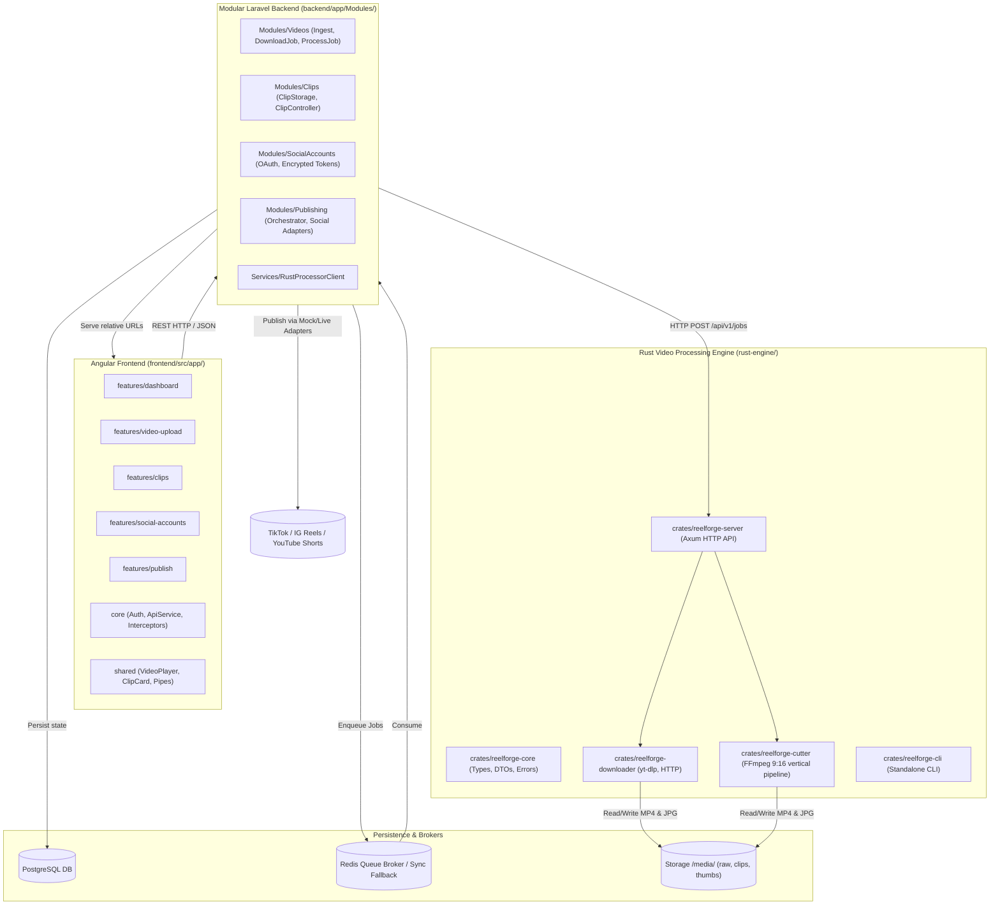

# Project: ReelForge

## Architecture

ReelForge is an automated video processing and social distribution platform designed to ingest long-form videos from public URLs or local uploads, split and transform segments into optimized vertical (9:16) short-form clips, and distribute them to connected social media platforms (TikTok, Instagram Reels, YouTube Shorts).

The architecture comprises three core technology pillars and an overarching testing infrastructure:
1. **Video Engine (`rust-engine/`)**: Multi-crate Cargo workspace (`reelforge-core`, `reelforge-downloader`, `reelforge-cutter`, `reelforge-server`, `reelforge-cli`) handling FFmpeg child processes, yt-dlp extraction, and exposing a local Axum REST API with Tokio semaphore-bounded concurrency.
2. **Modular Backend (`backend/`)**: Domain-driven Laravel 12 application structured under `app/Modules/` (`Videos`, `Clips`, `SocialAccounts`, `Publishing`), managing PostgreSQL persistence, Redis job queues, encrypted OAuth token storage, and social publishing adapters with pluggable mock implementations.
3. **User Interface (`frontend/`)**: Modern Angular 22 single-page application structured under `src/app/` (`core`, `features`, `layout`, `shared`), delivering video upload, clipping parameter configuration, interactive 9:16 preview playback, social connection management, and publishing/scheduling controls.
4. **Shared Media Persistence (`storage/media/`)**: Relative path structure (`media/raw/`, `media/clips/`, `media/thumbnails/`) accessible by both Rust and Laravel.



---

## Architectural Evaluation & Approval Verdict

### Verdict: **APPROVED WITH ARCHITECTURAL REMEDIATIONS**

The ReelForge reference architecture is approved for production implementation with six mandatory technical remediations:
1. **Asynchronous Axum Job Architecture**: Replaced the synchronous `POST /process` contract with an asynchronous `202 Accepted` job queue model (`POST /api/v1/jobs`) paired with status querying (`GET /api/v1/jobs/{id}`) and optional webhook callback to eliminate HTTP timeouts during transcoding.
2. **Downloader Ownership & Dual-Ingestion**: `reelforge-downloader` in Rust handles remote video downloads directly via `uvx yt-dlp` or binary, while also allowing Laravel to supply uploaded files via `local_video_path`.
3. **FFmpeg 9:16 Filter Standardization**: Standardized the `blur_padding` filter graph in `reelforge-cutter` so all clips output strictly at `1080x1920` (9:16) with AAC audio.
4. **First-Class Mock Social Publisher**: Mandated `MockSocialAdapter` implementing `SocialPublisherAdapterInterface` with deterministic latency and error simulation for offline testing without live credentials.
5. **Storage Path Normalization**: Established relative storage keys (`media/raw/{id}.mp4`, `media/clips/{id}/{clip_id}.mp4`, `media/thumbnails/{id}/{clip_id}.jpg`) shared across Rust and Laravel.
6. **Tokio Semaphore & Concurrency Caps**: Implemented Tokio semaphore bounds in `reelforge-server` and thread limits (`-threads 1`) on FFmpeg to accommodate single-core host CPU constraints (`nproc = 1`).

---

## Feature Inventory

Every discovered feature is assigned to a concrete milestone. No feature is left unassigned.

| # | Feature | Description | Milestone | Source |
|---|---------|-------------|-----------|--------|
| 1 | Multi-crate Rust Workspace | Virtual Cargo manifest linking 5 sub-crates with shared dependencies | M1 | Reference spec § 3, ORIGINAL_REQUEST R2 |
| 2 | Domain Models & Job State Machine | `reelforge-core` types, DTOs, lifecycle states, strongly-typed errors | M1 | Reference spec § 3, features_report § 2.2 |
| 3 | yt-dlp Subprocess Downloader | `reelforge-downloader` wrapper for yt-dlp with progress parsing | M1 | Reference spec § 3 & § 7, ORIGINAL_REQUEST R2 |
| 4 | Offline Video Fixture Fallback | `reelforge-downloader` mock loader using local MP4 fixtures for testing | M1 | features_report § 2.3 |
| 5 | Video Slicing & Timestamp Extraction | `reelforge-cutter` slicing routines via FFmpeg child processes | M1 | Reference spec § 3, ORIGINAL_REQUEST R2 |
| 6 | 9:16 Vertical Video Transformation | `reelforge-cutter` blur padding, center crop, and letterbox filtergraphs | M1 | Reference spec § 3, features_report § 2.4 |
| 7 | Keyframe Thumbnail Generation | `reelforge-cutter` midpoint JPEG frame capture via FFmpeg | M1 | Reference spec § 3, features_report § 2.4 |
| 8 | Axum HTTP Server API | `reelforge-server` endpoints (`GET /health`, `POST /api/v1/jobs`, `GET /api/v1/jobs/{id}`) | M1 | Reference spec § 3, ORIGINAL_REQUEST R2 |
| 9 | Axum Concurrency Semaphore | `reelforge-server` Tokio semaphore concurrency bound (1-slot for single-core) | M1 | spec_report § 2.1, features_report § 2.5 |
| 10 | Standalone CLI | `reelforge-cli` command-line tool with download, cut, probe, and batch commands | M1 | ORIGINAL_REQUEST R2, features_report § 2.6 |
| 11 | Modular Laravel Architecture | Domain-driven layout under `app/Modules/` (`Videos`, `Clips`, `SocialAccounts`, `Publishing`) | M2 | Reference spec § 2, ORIGINAL_REQUEST R3 |
| 12 | PostgreSQL Migrations & Schema | Tables for `videos`, `clips`, `social_accounts`, `publications` with UUID PKs and JSONB | M2 | Reference spec § 4, spec_report § 5.1 |
| 13 | Encrypted OAuth Token Storage | Eloquent `encrypted` casting for access/refresh tokens in `SocialAccount` model | M2 | Reference spec § 7, spec_report § 5.2 |
| 14 | Video Ingestion Service & REST API | `Modules/Videos` controller, requests, DTOs, and lifecycle status management | M2 | Reference spec § 2, features_report § 3.2 |
| 15 | Clip Management & Asset Serving | `Modules/Clips` controller, DTOs, metadata editing, and relative asset serving URLs | M2 | Reference spec § 2, features_report § 3.2 |
| 16 | Social Account Handshake & Management | `Modules/SocialAccounts` OAuth routes, account listing, disconnection, mock connect | M2 | Reference spec § 2, features_report § 3.2 |
| 17 | Social Publisher Strategy & Adapters | `SocialPublisherAdapterInterface` with TikTok, Instagram Reels, YouTube Shorts implementations | M2 | Reference spec § 2 & § 7, ORIGINAL_REQUEST R3 |
| 18 | Pluggable Mock Social Publisher | `MockSocialAdapter` with deterministic delay and simulation flags for testing without API keys | M2 | ORIGINAL_REQUEST R3, spec_report § 6.3 |
| 19 | Queue Job Orchestration | Redis queue jobs (`DownloadVideoJob`, `ProcessVideoJob`, publishing jobs) with sync testing fallback | M2 | Reference spec § 2, features_report § 3.4 |
| 20 | Rust Engine Client Service | `RustProcessorClient` communicating with Axum REST API | M2 | Reference spec § 2, features_report § 3.1 |
| 21 | Angular Feature Architecture | `frontend/src/app/` structured into `core`, `features`, `layout`, `shared` | M3 | Reference spec § 1, ORIGINAL_REQUEST R4 |
| 22 | Video Submission & Cutting Config UI | `features/video-upload` form with URL validation, strategy picker, duration sliders | M3 | Reference spec § 1, features_report § 4.2 |
| 23 | Clip Gallery & 9:16 Video Player | `features/clips` grid view and modal HTML5 video player formatted for 9:16 vertical reels | M3 | Reference spec § 1, features_report § 4.2 |
| 24 | Social Accounts Management UI | `features/social-accounts` cards, connection badges, token expiry alerts, mock connect toggle | M3 | Reference spec § 1, features_report § 4.2 |
| 25 | Publishing & Scheduling Modal | `features/publish` multi-platform selection, scheduling date picker, publication log table | M3 | Reference spec § 1, features_report § 4.2 |
| 26 | Dashboard Telemetry UI | `features/dashboard` quick metrics, recent jobs timeline, quick action triggers | M3 | Reference spec § 1, features_report § 4.2 |
| 27 | 8-Section Module READMEs | Dedicated local README with all 8 mandatory sections in every crate, module, and feature | M4 | user_global Rule 4, ORIGINAL_REQUEST R5 |
| 28 | Root Module Map Index | Root `README.md` indexing every project component and local README | M4 | user_global Rule 4, ORIGINAL_REQUEST R5 |
| 29 | Production Exclusion Configuration | `.gitignore` and build exclusions ensuring agent READMEs are not packaged for production | M4 | user_global Rule 4, ORIGINAL_REQUEST R5 |
| 30 | E2E Test Infrastructure & Runner | Unified test runner executing 4-tier automated test suites | M5 | ORIGINAL_REQUEST R1, TEST_INFRA |
| 31 | Tier 1 Feature Coverage Tests | ≥5 isolated unit tests per feature across Rust, Laravel, and Angular | M5 | features_report § 5.1 |
| 32 | Tier 2 Boundary & Edge Case Tests | ≥5 boundary/negative tests per feature (zero-byte files, expired tokens, corrupt URLs) | M5 | features_report § 5.2 |
| 33 | Tier 3 Cross-Feature Integration Tests | Inter-service integration (Axum ↔ Laravel client, queue dispatch, DB persistence) | M5 | features_report § 5.3 |
| 34 | Tier 4 Real-World Application Scenario | Synthetic end-to-end pipeline execution from raw MP4 generation to mock social publish | M5 | features_report § 5.4 |
| 35 | Tier 5 Adversarial Coverage Hardening | White-box adversarial testing, boundary fuzzing, and coverage gap remediation | M5 | Project Pattern § Phase 2 |

---

## Milestones

| # | Name | Scope | Dependencies | Status |
|---|------|-------|-------------|--------|
| M1 | Video Processing Engine (Rust) | Multi-crate workspace `rust-engine/` (`reelforge-core`, `reelforge-downloader`, `reelforge-cutter`, `reelforge-server`, `reelforge-cli`), unit tests, local READMEs | None | DONE |
| M2 | Modular Backend (Laravel) | `backend/` modular layout in `app/Modules/` (`Videos`, `Clips`, `SocialAccounts`, `Publishing`), PostgreSQL migrations, Redis queues, `RustProcessorClient`, `MockSocialAdapter`, unit/API tests, local READMEs | Interface Contracts | DONE |
| M3 | User Interface (Angular) | `frontend/` feature-based architecture (`core`, `features`, `layout`, `shared`), components, DTOs, services, zoneless signal reactivity, build clean, 62 tests pass, local READMEs | Interface Contracts | DONE |
| M4 | Root Documentation & Module Map | Root `README.md` module map indexing all crates, modules, and features; audit of 8-section local READMEs; production exclusion rules | M1, M2, M3 | DONE |
| M5 | Final Milestone: E2E Test Suite & Adversarial Hardening | Phase 1: Pass 100% of E2E test suite (Tiers 1-4). Phase 2: Adversarial coverage hardening (Tier 5) | M1, M2, M3, TEST_READY.md | PLANNED |

In parallel from the start:
- **E2E Testing Track**: Autonomous track designing opaque-box test runner, test infrastructure (`TEST_INFRA.md`), and test cases (Tiers 1-4) derived from user requirements. Publishes `TEST_READY.md`.

---

## Interface Contracts

### 1. Axum HTTP Engine ↔ Laravel Backend Contract

#### Base URL: `http://localhost:3000` (or `http://rust-engine:3000`)

#### `GET /health`
- **Response `200 OK`**:
```json
{
  "status": "healthy",
  "version": "0.1.0",
  "concurrency": {
    "active_jobs": 0,
    "max_concurrent_jobs": 1,
    "available_permits": 1
  },
  "uptime_seconds": 120
}
```

#### `POST /api/v1/jobs`
- **Request Body**:
```json
{
  "job_id": "8a3d5e21-0d32-474c-897b-9fbf2b349d10",
  "source_url": "https://example.com/video.mp4",
  "local_video_path": null,
  "strategy": "fixed_interval",
  "interval_seconds": 30,
  "max_duration_seconds": 60,
  "aspect_ratio": "9:16",
  "vertical_mode": "blur_padding",
  "output_dir": "media/clips/8a3d5e21-0d32-474c-897b-9fbf2b349d10",
  "webhook_url": null
}
```
- **Response `202 Accepted`**:
```json
{
  "job_id": "8a3d5e21-0d32-474c-897b-9fbf2b349d10",
  "status": "queued",
  "message": "Job accepted and queued for processing"
}
```

#### `GET /api/v1/jobs/:id`
- **Response `200 OK` (Completed)**:
```json
{
  "job_id": "8a3d5e21-0d32-474c-897b-9fbf2b349d10",
  "status": "completed",
  "progress_percent": 100,
  "clips": [
    {
      "clip_id": "b1e7f3c4-0001-4b1a-8293-112233445566",
      "file_path": "media/clips/8a3d5e21-0d32-474c-897b-9fbf2b349d10/clip_001.mp4",
      "thumbnail_path": "media/thumbnails/8a3d5e21-0d32-474c-897b-9fbf2b349d10/thumb_001.jpg",
      "start_time": 0.0,
      "end_time": 30.0,
      "duration": 30.0,
      "width": 1080,
      "height": 1920
    }
  ],
  "error_message": null,
  "execution_duration_ms": 4500
}
```

---

### 2. Laravel Backend ↔ Angular Frontend REST API Contract

#### `POST /api/videos`
- Request: `{"source_url": "https://...", "strategy": "fixed_interval", "interval_seconds": 30, "vertical_mode": "blur_padding"}`
- Response `201 Created`: `{"id": "uuid", "source_url": "...", "status": "pending", "created_at": "..."}`

#### `GET /api/videos/:id/status`
- Response `200 OK`: `{"id": "uuid", "status": "processing", "progress_percent": 65, "error_message": null}`

#### `GET /api/videos/:id/clips`
- Response `200 OK`: `{"data": [{"id": "uuid", "video_id": "uuid", "file_url": "/storage/media/clips/...", "thumbnail_url": "/storage/media/thumbnails/...", "duration": 30.0, "start_time": 0.0, "end_time": 30.0, "status": "ready"}]}`

#### `POST /api/clips/:id/publish`
- Request: `{"platforms": ["tiktok", "instagram"], "caption": "Awesome clip #fyp", "scheduled_at": null}`
- Response `202 Accepted`: `{"publication_ids": ["uuid-1", "uuid-2"], "status": "queued"}`

#### `GET /api/social-accounts`
- Response `200 OK`: `{"data": [{"id": "uuid", "platform": "tiktok", "platform_username": "@creator", "connected_at": "...", "is_mock": true}]}`

#### `POST /api/social-accounts/mock-connect`
- Request: `{"platform": "tiktok", "username": "test_creator"}`
- Response `201 Created`: `{"id": "uuid", "platform": "tiktok", "platform_username": "test_creator", "is_mock": true}`

---

### 3. Social Publisher Adapter Interface (PHP)

```php
namespace App\Modules\Publishing\Contracts;

use App\Modules\Clips\Models\Clip;
use App\Modules\SocialAccounts\Models\SocialAccount;
use App\Modules\Publishing\DTOs\PublishResult;

interface SocialPublisherAdapterInterface
{
    public function getPlatform(): string;
    public function publish(Clip $clip, SocialAccount $account, array $options = []): PublishResult;
    public function refreshToken(SocialAccount $account): bool;
    public function validateAccount(SocialAccount $account): bool;
}
```

---

## Code Layout

```
/home/omicron/Documentos/creador de reels/
├── rust-engine/                      # M1: Rust Multi-Crate Video Processing Engine
│   ├── Cargo.toml                    # Workspace manifest
│   ├── README.md                     # Agent local README (8 sections)
│   └── crates/
│       ├── reelforge-core/
│       │   ├── Cargo.toml
│       │   ├── README.md
│       │   └── src/{lib.rs, models.rs, state.rs, errors.rs}
│       ├── reelforge-downloader/
│       │   ├── Cargo.toml
│       │   ├── README.md
│       │   └── src/{lib.rs, ytdlp.rs, parser.rs, fixtures.rs, probe.rs}
│       ├── reelforge-cutter/
│       │   ├── Cargo.toml
│       │   ├── README.md
│       │   └── src/{lib.rs, ffmpeg.rs, filtergraph.rs, thumbnail.rs, validator.rs}
│       ├── reelforge-server/
│       │   ├── Cargo.toml
│       │   ├── README.md
│       │   └── src/{main.rs, routes.rs, handlers.rs, state.rs, worker.rs}
│       └── reelforge-cli/
│           ├── Cargo.toml
│           ├── README.md
│           └── src/main.rs
├── backend/                          # M2: Modular Laravel Backend
│   ├── README.md                     # Agent local README (8 sections)
│   ├── composer.json
│   ├── artisan
│   ├── app/
│   │   ├── Modules/
│   │   │   ├── Videos/
│   │   │   │   ├── README.md
│   │   │   │   ├── Controllers/VideoController.php
│   │   │   │   ├── Models/Video.php
│   │   │   │   ├── Services/VideoIngestService.php
│   │   │   │   ├── Jobs/{DownloadVideoJob.php, ProcessVideoJob.php}
│   │   │   │   ├── DTOs/VideoIngestDTO.php
│   │   │   │   └── Routes/api.php
│   │   │   ├── Clips/
│   │   │   │   ├── README.md
│   │   │   │   ├── Controllers/ClipController.php
│   │   │   │   ├── Models/Clip.php
│   │   │   │   ├── Services/ClipStorageService.php
│   │   │   │   └── Routes/api.php
│   │   │   ├── SocialAccounts/
│   │   │   │   ├── README.md
│   │   │   │   ├── Controllers/OAuthController.php
│   │   │   │   ├── Models/SocialAccount.php
│   │   │   │   ├── Services/{TikTokOAuthService.php, InstagramOAuthService.php, YouTubeOAuthService.php}
│   │   │   │   └── Routes/api.php
│   │   │   └── Publishing/
│   │   │       ├── README.md
│   │   │       ├── Controllers/PublishController.php
│   │   │       ├── Models/Publication.php
│   │   │       ├── Services/PublishingOrchestrator.php
│   │   │       ├── Contracts/SocialPublisherAdapterInterface.php
│   │   │       ├── Adapters/{TikTokPublisherAdapter.php, InstagramPublisherAdapter.php, YouTubePublisherAdapter.php, MockSocialAdapter.php}
│   │   │       ├── Jobs/{PublishToTikTokJob.php, PublishToInstagramJob.php, PublishToYouTubeJob.php}
│   │   │       └── Routes/api.php
│   │   └── Services/RustProcessorClient.php
│   ├── database/migrations/
│   └── tests/
├── frontend/                         # M3: Modern Angular Frontend
│   ├── README.md                     # Agent local README (8 sections)
│   ├── package.json
│   ├── angular.json
│   └── src/
│       ├── index.html
│       ├── main.ts
│       └── app/
│           ├── core/
│           │   ├── README.md
│           │   ├── auth/
│           │   ├── interceptors/
│           │   ├── services/
│           │   └── models/
│           ├── features/
│           │   ├── dashboard/
│           │   ├── video-upload/
│           │   ├── clips/
│           │   ├── social-accounts/
│           │   └── publish/
│           ├── layout/
│           └── shared/
├── storage/                          # Shared media storage
│   └── media/
│       ├── raw/
│       ├── clips/
│       └── thumbnails/
├── tests/e2e/                        # M5 / E2E Testing Track Opaque-Box Test Suite
│   ├── test_runner.sh
│   ├── tier1_features/
│   ├── tier2_boundaries/
│   ├── tier3_combinations/
│   └── tier4_real_world/
├── README.md                         # M4: Root Module Map Index
├── TEST_INFRA.md                     # E2E Testing Track Infrastructure Index
└── TEST_READY.md                     # Signal published upon test suite completion
```
